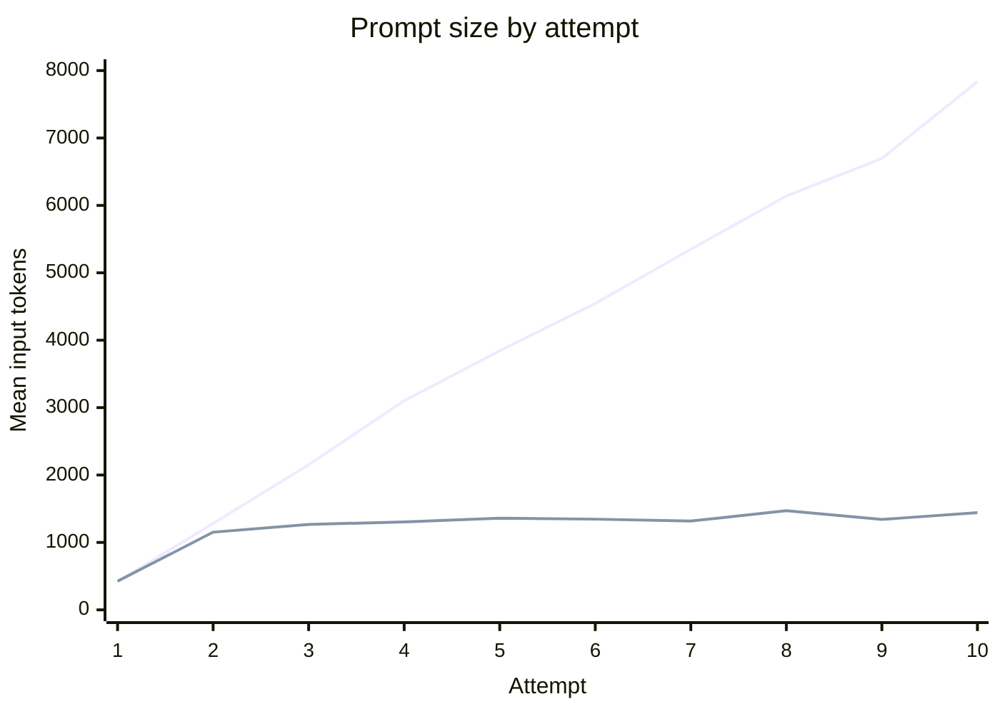
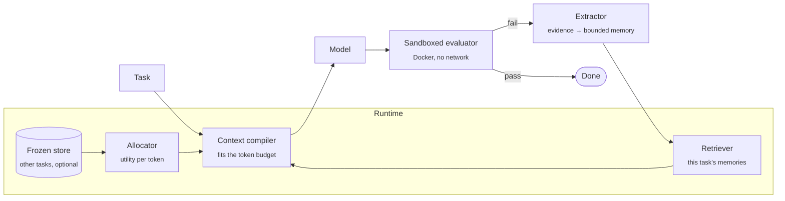

<div align="center">

# TokenOS

**Bounded failure memory for coding agents.**<br>
Learn from every failed attempt without replaying all of them.


[Results](#results) · [How it works](#how-it-works) · [Quickstart](#quickstart) ·
[CLI](#command-line) · [Setup](#setup) · [Design notes](#design-notes)

</div>

---

When a coding agent retries a failed task, the usual move is to hand the model
**everything**: every earlier completion and every test failure. The prompt
grows with each attempt, and most of it is stale.

TokenOS takes a different approach. It turns each failure into a small,
validated **memory**, keeps only the **latest working implementation**, tells
the model when it is **repeating a mistake**, and compiles all of it into a
prompt that fits a **token budget** you choose.

```python
from tokenos import Runtime

runtime = Runtime(context_budget=8000)
result = runtime.run(problem)

result.passed        # True
result.total_tokens  # what the whole trajectory cost
```

## Results

Measured on the **32 BigCodeBench-Hard tasks** whose reference solutions pass
in the evaluator sandbox. Each task gets up to **ten attempts**. Model:
`gpt-5.4-mini`. Two runs with identical settings, pooled (64 paired
trajectories per strategy):

| Strategy | What each retry sees | Solved | Tokens | Input tokens | Tokens per solve |
|---|---|:-:|--:|--:|--:|
| Full history | every completion + every failure | 51/64 | 1,571,888 | 723,955 | 30,821 |
| **TokenOS** (`patchsearch-adaptive`) | bounded memory + latest valid code + stuck detection | **53/64** | **995,660** | **268,984** | **18,786** |

> **37% fewer tokens, 63% less input, 39% less per solved problem, at equal
> correctness.** TokenOS solved more tasks in both runs (28 vs 27, then 25 vs
> 24). The difference in solves is not significant (McNemar exact test, 6 vs 4
> discordant tasks, p = 0.75), so the accurate claim is *parity*, not
> superiority. The token saving held in both runs (41%, then 33%).

Runs `20261007T055643Z-cd5774` and `20261007T065630Z-1cba26`, $9.73 together.

### Context growth

Mean input tokens per request by attempt, averaged over the two runs
(reported by the API):



Full history grows with every attempt. TokenOS levels off after the first
retry, so the saving grows the longer an agent keeps trying.

### How it got here

Each step was a measured fix for a measured failure:

| Change | Evidence |
|---|---|
| Bounded failure memory | No memory solves 10/32; memory alone 18/32 |
| Keep the latest code | 18/32 → 21/32, and 18% cheaper per solve than memory alone |
| Raise the output cap 4K → 16K | Every invalid response (13–23% of attempts) had hit the cap; at 16K, 1 in 405 |
| Detect repeated failures | Bounded memory was losing tasks by making the same mistake up to ten times running, because identical failures merge into one memory. Repeat counts, a STUCK directive and the latest raw test output turned a 2-task deficit (24 vs 26) into a 1-task lead |

And two things that did **not** work, recorded rather than hidden:

- **A tight context budget.** At 1,000 tokens the compiler drops the code, and
  correctness fell to 16/32 against full history's 24/32 (p = 0.008). Keep the
  budget above the size of the code; the default of 8,000 never binds here.
- **Cross-task memory.** Across 186 memories from 27 tasks only one pair of
  tasks shared a failure mode, so carrying other tasks' memories made prompts
  larger without helping. It needs a benchmark where the same mistakes recur.

### Caveats

- **Small sample.** Only 32 tasks run in the default sandbox, and identical
  runs differ by about three tasks. Parity at n = 64 rules out a large
  correctness cost, not a small one.
- **One model.** Every result is `gpt-5.4-mini`. Open models run through
  `TOKENOS_PROVIDER_API=chat` but have not been measured yet.
- **The TokenOS strategy was tuned on these tasks.** Stuck detection was
  designed after inspecting failures in run `20261007T045053Z-f3837c`, then
  tested on two fresh runs. A held-out task set would be a stronger test.

The full record, including every negative result, is in [plan.md](plan.md).

## How it works



| Stage | Module | What it does |
|---|---|---|
| **Evaluate** | [`evaluator.py`](src/tokenos/evaluator.py), [`adapters.py`](src/tokenos/adapters.py) | Runs the candidate in a locked-down container and normalises the benchmark's output into typed `FailureEvidence`. |
| **Extract** | [`patchsearch/extractor.py`](src/tokenos/patchsearch/extractor.py) | Turns evidence into one `FailureMemory`: an **executable assertion** when the evaluator supplies a trusted failing input and expected output, otherwise a **bounded summary**. |
| **Validate** | [`patchsearch/validator.py`](src/tokenos/patchsearch/validator.py) | Checks assertions with Python's AST and literal parser, without executing candidate code on the host. |
| **Retrieve** | [`patchsearch/retriever.py`](src/tokenos/patchsearch/retriever.py) | Deduplicates the task's memories: assertions first, then summaries newest first. |
| **Detect repeats** | [`strategies.py`](src/tokenos/strategies.py) | Counts how often each failure recurred and, after two identical failures in a row, tells the model it is stuck and should change approach. Deduplication keeps memory bounded but would otherwise hide the repetition. |
| **Allocate** | [`allocator.py`](src/tokenos/allocator.py), [`store.py`](src/tokenos/store.py) | Optionally ranks memories from other tasks by *relevance × importance × confidence ÷ cost*. |
| **Compile** | [`compiler.py`](src/tokenos/compiler.py) | Fits everything into the token budget and renders the prompt. |
| **Run** | [`runtime.py`](src/tokenos/runtime.py) | Loops over attempts on one task. [`runner.py`](src/tokenos/runner.py) does the same across a dataset, in parallel, for benchmarking. |

### The context compiler

The compiler renders prompts with the same `build_prompt` the benchmark
measured. It is checked against real data: replaying run
`20260901T024612Z-bf19df`, it reproduces **all 194 recorded PatchSearch prompts
byte for byte** when no budget is set. So the Runtime runs the strategy that
was benchmarked, not a lookalike.

When the budget is tight, the compiler keeps context in this priority order,
taken from the ablations above:

1. **The task** is always kept. If the task alone doesn't fit, the compiler
   raises `ContextBudgetError` instead of truncating it.
2. **Executable assertions** from this task.
3. **Summaries** from this task, newest first.
4. **The latest valid completion** and its test output, kept or dropped
   whole. Truncated code would mislead the model more than no code.
5. **Memories from other tasks** get whatever budget is left.

Token counts are estimated conservatively, so no tokenizer dependency is
needed. The densest text across 707 real requests was 3.34 UTF-8 bytes per
token; dividing by 3.0 overestimates every one of them.

## Quickstart

```bash
python3.12 -m venv .venv && source .venv/bin/activate
python -m pip install -e '.[dev]'
python -m pytest            # 165 tests, no network or Docker needed
```

### Use the Runtime with your own model and tests

`provider` and `evaluator` are simple protocols. Supply your own and the
Runtime needs no Azure or Docker setup:

```python
from tokenos import Problem, Runtime

problem = Problem(
    task_id="demo/double",
    prompt='def double(x):\n    """Return x doubled."""\n',
    entry_point="double",
)

runtime = Runtime(
    context_budget=2000,
    provider=my_model,        # .generate(prompt, *, instructions) -> ModelResponse
    evaluator=my_tests,       # .evaluate(problem, solution) -> EvaluationResult
)
result = runtime.run(problem)

for attempt in result.attempts:
    ctx = attempt.context
    print(attempt.record.attempt, attempt.passed,
          ctx.estimated_tokens, len(ctx.memories), ctx.included_code)
```

If you leave out `provider` and `evaluator`, the Runtime uses Azure OpenAI and
the Docker sandbox, configured from the [environment](#configuration). It also
enforces a spend cap (`budget_usd`, $1 by default).

## Command line

| Command | Spends tokens | What it does |
|---|:-:|---|
| `tokenos solve TASK_ID` | ✓ | Solve one task with the Runtime and print each attempt's context |
| `tokenos benchmark` | ✓ | Compare strategies across a dataset |
| `tokenos resume RUN_ID` | ✓ | Continue a run interrupted by the spend cap or an error |
| `tokenos report RUN_ID` | | Print a run's summary |
| `tokenos growth RUN_ID` | | Prompt size by attempt, from API-reported usage |
| `tokenos sweep RUN_ID` | | Re-run the compiler on recorded attempts at several budgets |
| `tokenos preflight` | | Find the tasks whose reference solution runs in the evaluator image |
| `tokenos doctor` | opt-in | Check local setup; `--live` makes one small request |
| `tokenos dataset fetch` | | Download a pinned dataset |

`solve` prints one line per attempt: the outcome, the compiled and billed
token counts, and what the compiler kept or dropped. The Runtime has been
tested end to end in both sandboxes, with a scripted model whose first attempt
is deliberately wrong:

| Task | Attempt 1 | Memory carried to attempt 2 | Attempt 2 |
|---|---|---|---|
| HumanEval/0 | wrong answer, ~309 tokens | `assert has_close_elements(*([1.0, 2.0, 3.9, 4.0, 5.0, 2.2], 0.3)) == True` | pass, ~387 tokens |
| BigCodeBench/19 | wrong answer, ~496 tokens | *"Previous candidate failed an assertion: FileNotFoundError not raised. Test: test_non_existent_directory."* | pass, ~593 tokens |

HumanEval+ provides the failing input and expected output, so its failure
became an executable assertion. BigCodeBench provides only a unittest message,
so its failure became a bounded summary.

`sweep` shows what a budget would have cut before you pay to find out:

```console
$ tokenos sweep 20260901T024612Z-bf19df --budgets 4000,1500,1000
  patchsearch-with-code
    unbounded: 90 attempts, 101229 tokens; 90 prompts reproduced byte-for-byte, ...
      4000: 101229 tokens, 0 trimmed (code dropped 0, memories dropped 0), ...
      1500: 83257 tokens, 18 trimmed (code dropped 18, memories dropped 1), ...
      1000: 66771 tokens, 48 trimmed (code dropped 47, memories dropped 18), ...
```

At the default budget of 8,000 tokens nothing is cut on this benchmark. Tighter
budgets drop the code first, and a live run
shows that costs correctness. With a budget of 1,000 tokens (run
`20261007T033256Z-4affde`), with-code solved 16/32 against full history's
24/32 in the same run (8 tasks lost, none gained, p = 0.008). It also solved
fewer than either unbounded run (21/32 and 19/32) and cost 20% more tokens per
solve than full history. Keep the budget above the size of the code.

## Setup

Live runs need Python 3.12, Docker Desktop with at least 2 GB of memory
available, and an Azure OpenAI deployment.

<details>
<summary><b>Azure deployment</b></summary>

Provision the model in the Microsoft Foundry portal:

1. Create or select an Azure OpenAI resource in a region that supports the
   Responses API and `gpt-5.4-mini`.
2. Create a **Global Standard** deployment of `gpt-5.4-mini`, version
   `2026-03-17`, named `tokenos-gpt-54-mini`.
3. Confirm that the deployment quota supports four concurrent trajectories.
4. Copy the endpoint and, for API-key authentication, a key.

TokenOS calls the v1 endpoint at `<endpoint>/openai/v1/` with reasoning effort
`medium`, a 4,096-token output limit, structured JSON output, and `store=false`.

</details>

<details id="configuration">
<summary><b>Configuration</b></summary>

Set the variables shown in `.env.example`. Token prices must match your region
and deployment type, because they drive the spend cap.

```bash
# API key
export AZURE_OPENAI_AUTH=api_key
export AZURE_OPENAI_API_KEY=...
# or Entra ID (after `az login`)
export AZURE_OPENAI_AUTH=entra

export AZURE_OPENAI_ENDPOINT=https://YOUR-RESOURCE.openai.azure.com
export AZURE_OPENAI_DEPLOYMENT=tokenos-gpt-54-mini
export AZURE_OPENAI_INPUT_USD_PER_MTOK=...
export AZURE_OPENAI_CACHED_INPUT_USD_PER_MTOK=...
export AZURE_OPENAI_OUTPUT_USD_PER_MTOK=...

# Open models: any OpenAI-compatible chat endpoint (a Foundry serverless
# deployment, OpenRouter, vLLM). An endpoint ending in /v1 is used as given.
export TOKENOS_PROVIDER_API=chat
export TOKENOS_MODEL_NAME=qwen3-coder-30b-a3b

tokenos doctor          # local checks, no tokens
tokenos doctor --live   # one small request
```

</details>

<details>
<summary><b>Datasets and evaluator images</b></summary>

```bash
# HumanEval+ v0.1.10: the regression check
tokenos dataset fetch
docker build -t tokenos-evalplus:0.3.1 -f docker/Dockerfile .

# BigCodeBench-Hard v0.1.4: the harder benchmark
tokenos dataset fetch --name bigcodebench-hard
docker build -t tokenos-bigcodebench-stdlib:0.3.0 \
  -f docker/BigCodeBenchStdlib.Dockerfile .
tokenos preflight --dataset bigcodebench-hard --all
```

Each dataset is checked against a pinned SHA-256, which is also written into
every run manifest. The default BigCodeBench image supports only tasks that
use the Python standard library. 32 of the 148 Hard tasks pass preflight in
it. The optional `docker/BigCodeBench.Dockerfile` builds on the official
evaluator image for broader coverage. It is about 9 GB and runs under
emulation on ARM Macs.

</details>

<details>
<summary><b>Running benchmarks</b></summary>

```bash
tokenos benchmark \
  --dataset bigcodebench-hard --all --skip-unviable-tasks \
  --strategies full-history,patchsearch-adaptive \
  --max-attempts 10 --budget-usd 10 --concurrency 4
```

`--max-output-tokens` defaults to 16,384. Reasoning tokens count against it,
and at 4,096 a reasoning model ran out mid-answer on 13–23% of attempts.

`--context-budget N` makes the context compiler enforce an N-token budget on
the bounded-memory strategies, exactly as the Runtime does. Full history is
never compiled. What the compiler kept or dropped for each request is logged
in `events.jsonl`. Without the flag, prompts are identical to earlier runs.

Strategies:

- `patchsearch-adaptive`: **TokenOS**, the Runtime's default.
- `full-history`: the unbounded baseline. `sliding-window` is the same, cut to
  the newest attempts that fit `--context-budget` (required).
- `no-memory`, `patchsearch` (memory, no code), `patchsearch-with-code` (latest
  code, unparsed or not), `patchsearch-best-code` (fewest failing tests):
  ablations.
- `patchsearch-crosstask` (requires `--memory-store RUN_ID`) and
  `patchsearch-explained` (discontinued): kept so past results reproduce.

Each run writes `runs/<run-id>/`, which git ignores:

- `manifest.json`: the fixed configuration and a hash for reproducing it
- `events.jsonl`: an append-only log of every request and attempt
- `summary.json`: correctness, token, cost and latency metrics
- `samples.jsonl`: the final sample per task and strategy, in EvalPlus format

`solve@k` is the cumulative share of tasks solved within *k* adaptive retries.
It is not the classical independent-sampling `pass@k`.

</details>

## Design notes

**Spend is capped before the call, not after.** Before each call, TokenOS
reserves the worst-case cost of the prompt plus the maximum output, and it
schedules no call that couldn't fit in the remaining budget. Raising the cap
takes an explicit `resume --budget-usd`, which is logged in the run's event
history. The cap is an estimate from your configured prices, not an Azure
billing guarantee.

**Runs are resumable and deterministic.** Attempts are appended to a log as
they happen, so an interrupted run rebuilds the same memory when it resumes.
The cross-task store is frozen for a run, so a task's context never depends
on which other tasks a thread happened to finish first.

**Evidence is benchmark-neutral.** New Python benchmarks plug in by
registering a `BenchmarkAdapter`; core extraction never branches on benchmark
names. Evaluator text is sanitised before it is saved. Assertions never cross
task boundaries: every BigCodeBench task defines `task_func`, so a transferred
assertion would silently test the wrong function.

**Generated code runs in a sandbox.** Each program runs in a fresh container
with no network, no workspace mount and no credentials. The container has a
read-only root filesystem, all Linux capabilities dropped,
`no-new-privileges`, process and memory limits, one CPU, and a host timeout.
Docker reduces risk substantially but is not a perfect hostile-code sandbox;
don't weaken these controls.

<details>
<summary><b>Live tests</b></summary>

```bash
TOKENOS_RUN_AZURE_TEST=1 python -m pytest -m azure
TOKENOS_RUN_DOCKER_SECURITY_TESTS=1 python -m pytest -m docker
```

</details>

## Roadmap

- [x] **Phase 1:** reproducible benchmark harness, spend cap, sandboxed evaluation
- [x] **Phase 2:** PatchSearch, benchmark-neutral failure evidence, preflight
- [ ] **Phase 3 (partial):** Memory is typed (assertion or summary). The
  planned FACT and DECISION types have no evidence behind them yet.
- [x] **Phase 4:** cross-task store and heuristic token allocator
- [x] **Phase 5:** `Runtime` and the budget-enforcing context compiler
- [x] Measure what a binding budget costs: at 1,000 tokens with-code drops to 16/32 (vs 24/32 full history, p = 0.008)
- [x] Fix the output cap and stuck loops; reach parity with full history at 37% fewer tokens, replicated
- [ ] Held-out tasks (a fuller evaluator image), since stuck detection was designed on these 32
- [ ] A second model, through `TOKENOS_PROVIDER_API=chat`
- [ ] Equal-budget comparison: TokenOS vs `sliding-window` at the same context budget
- [ ] A benchmark with recurring failure modes, so cross-task allocation can be tested fairly
- [ ] **Phase 6:** full-benchmark evaluation with tables and graphs

## License

MIT
